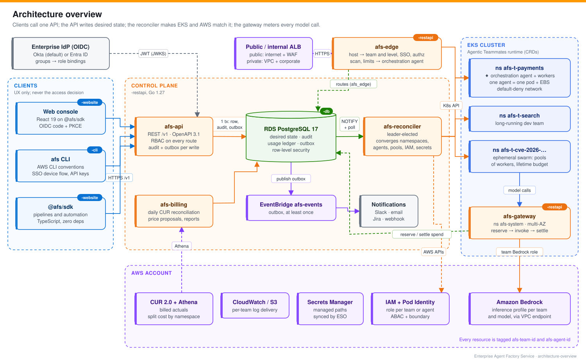
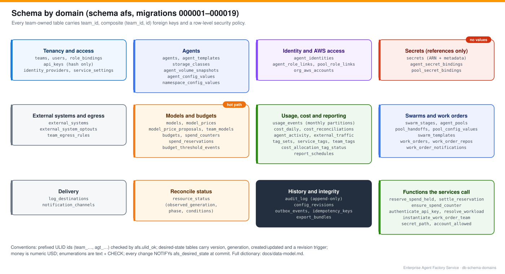
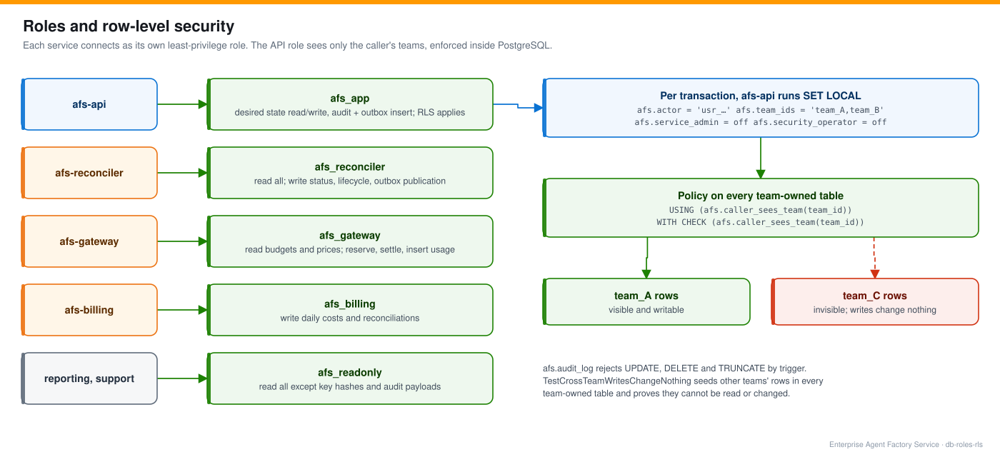

# enterprise-agent-factory-service-db

**The database of the [Enterprise Agent Factory Service](https://github.com/stainedhead/enterprise-agent-factory-service):
the RDS PostgreSQL 17 schema that holds every team's desired state, and the roles and row-level security that
keep teams apart.**

It ships as a Go module (`migrations`, `migrate`) that `afs-api` runs at startup, plus the `afs-migrate`
command for operators. All desired state lives here: teams, people and role bindings, agents and their
identities, secret *references*, models and prices, budgets and spend, usage and costs, delivery settings,
swarms and work orders, together with reconcile status, the event outbox, config revisions and the
append-only audit log.

| | |
|---|---|
| **Operate it** | [Getting started](user-docs/getting-started.md) · [Configuration](user-docs/configuration.md) · [Operations](user-docs/operations.md) |
| **Understand it** | [Data dictionary](docs/data-model.md) · [Technical details](docs/technical-details.md) · [Decisions](docs/architectural-decision-record.md) · [PRD](enterprise-agent-factory-service-db-PRD.md) |
| **Change it** | [CONTRIBUTING.md](CONTRIBUTING.md) · [AGENTS.md](AGENTS.md) · [Database contract](https://github.com/stainedhead/enterprise-agent-factory-service/blob/main/docs/contracts/database-contract.md) |

## Where it fits



The only code consumer is [-restapi](https://github.com/stainedhead/enterprise-agent-factory-service-restapi),
which imports this module at a released tag and connects as the roles defined here. The reconciler listens to
the change feed (`LISTEN afs_desired_state`), and the gateway reserves and settles spend through functions
in this schema.

## The schema



Design rules that every migration follows:

- **Everything in schema `afs`**, tracked in `public.afs_schema_migrations`; migrations are append-only once
  merged, contiguous, one transaction each, and online-safe.
- **Team scoping.** Every team-owned table has `team_id`; references inside a team use composite
  `(team_id, id)` foreign keys, so a row can never point at another team's row.
- **No secret values, ever.** Secrets are Secrets Manager ARNs and metadata. A test fails if a column name
  looks like it could hold a value.
- **Money is `numeric` USD**; enumerations are `text` + `CHECK`; ids are prefixed ULIDs (`team_…`, `agt_…`).
- **Desired-state tables** carry `version` (for `If-Match`), `generation`, timestamps and a revision trigger.

## Roles and row-level security



Each service connects as its own least-privilege role. `afs-api` sets `afs.actor`, `afs.team_ids` and
`afs.service_admin` with `SET LOCAL` in every transaction, so PostgreSQL itself hides other teams' rows even if
application code got a filter wrong. `afs.audit_log` rejects `UPDATE`, `DELETE` and `TRUNCATE`.

## Use

```bash
# once per cluster, as the RDS master user
psql "$ADMIN_URL" -f bootstrap/roles.sql       # or: afs-migrate --database-url "$ADMIN_URL" bootstrap-roles

# apply migrations, as a member of afs_owner
go run ./cmd/afs-migrate --database-url "$AFS_DATABASE_URL" up
```

From Go (as `afs-api` does at startup):

```go
migs, _ := migrate.Load(migrations.FS)
n, err := migrate.Up(ctx, conn, migs) // each migration waits at most 10 s for a lock (migrate.WithLockTimeout)
```

## Build and test

Requires Go 1.27 (pinned in `go.mod`), `make`, and PostgreSQL 17 or Docker for the integration tests.

```bash
make gate       # unit tests, lint, build
make db-up      # postgres:17 in Docker on :55432
make test-db    # up/down/up, checksums, constraints, spend reservation, row-level security, change feed
make cover      # migrate coverage (set AFS_TEST_DATABASE_URL for the integration tests)
```

## Status

Feature complete at schema `000021`: migrations `000001_core_schema` to `000021_collab_routes_provider_clients`, with
integration tests that prove every acceptance criterion of the [PRD](enterprise-agent-factory-service-db-PRD.md)
this repository can prove. 000020 adds Paperclip team collaboration (a collaboration agent per team, its settings, managed secrets, and the `afs_edge` role); operators run `afs-migrate bootstrap-roles` before the release that embeds it. 000021 adds the identity provider's console and CLI client ids to `collab_routes()` so the edge accepts REST bearer tokens from CLI and console sign-in. The release is `v1.0.1` (see `CHANGELOG.md`); `-db` and `-restapi` share version numbers.

## Contributing

Read [CONTRIBUTING.md](CONTRIBUTING.md) and the product-wide
[contributing guide](https://github.com/stainedhead/enterprise-agent-factory-service/blob/main/CONTRIBUTING.md).
Why this repository exists: [INTENT.md](INTENT.md).
