# Data model

Schema `afs`, PostgreSQL 17. Source: `migrations/`. Keep this file in step with every migration.

## Entity overview

```mermaid
erDiagram
    teams ||--o{ role_bindings : "grants"
    users ||--o{ role_bindings : "holds"
    teams ||--o{ api_keys : ""
    teams ||--o{ agents : ""
    teams ||--o{ secrets : ""
    teams ||--o{ team_models : "enables"
    models ||--o{ team_models : ""
    models ||--o{ model_prices : "priced by"
    agents ||--o{ agent_secret_bindings : ""
    agents ||--o{ agent_volume_snapshots : ""
    agents ||--o{ agent_config_values : ""
    agents ||--o{ agent_role_links : ""
    org_aws_accounts ||--o{ agent_role_links : ""
    teams ||--o{ namespace_config_values : ""
    storage_classes ||--o{ agents : ""
    secrets ||--o{ agent_secret_bindings : ""
    teams ||--o{ agent_identities : ""
    agents ||--o{ agent_identities : ""
    teams ||--o{ external_systems : "declares"
    external_systems ||--o{ external_system_optouts : ""
    agents ||--o{ external_system_optouts : ""
    external_systems ||--o{ secrets : "credential for"
    teams ||--|| budgets : "has"
    budgets ||--o{ spend_counters : "per period"
    spend_counters ||--o{ spend_reservations : "held"
    budgets ||--o{ budget_threshold_events : ""
    teams ||--o{ usage_events : ""
    teams ||--o{ cost_daily : ""
    agents ||--o{ agent_activity : "samples"
    agents ||--o{ external_traffic : "flows"
    teams ||--o{ cost_reconciliations : ""
    teams ||--o{ log_destinations : ""
    teams ||--o{ notification_channels : ""
    teams ||--o{ work_orders : ""
    teams ||--o{ resource_status : ""
    teams ||--o{ tag_sets : "snapshots"
    tag_sets ||--o{ cost_daily : "tags at the time"
    notification_channels ||--o{ report_schedules : "delivers"
    teams ||--o{ report_schedules : ""
    teams ||--o{ swarm_stages : ""
    swarm_stages ||--o{ agent_pools : "groups"
    teams ||--o{ agent_pools : "swarm"
    agent_pools ||--o{ pool_secret_bindings : ""
    agent_pools ||--o{ pool_config_values : ""
    agent_pools ||--o{ pool_role_links : ""
    agent_pools ||--o{ pool_handoffs : "hands to"
    agent_pools ||--o{ agent_identities : ""
    agent_pools ||--o{ agent_activity : "worker samples"
    swarm_templates ||--o{ work_orders : "instantiates"
    work_orders ||--o{ work_order_repos : "affected"
    work_order_repos ||--o{ work_order_notifications : ""
```

## Tables

| Table | Purpose | Key columns and rules |
|---|---|---|
| `service_settings` | Service-wide settings (key → JSON). Keys with checked values include `secrets.path_prefix`, `pricing.price_list_sync`, `billing.variance_alert_pct`, `api.idempotency_key_ttl_seconds` (60–604800, default 3600), `teams.ephemeral_max_days` (1–365, default 90), `work_orders.sla_warning_hours` (1–720, default 48), `billing.tag_activation_acknowledged`, `work_orders.notification_channel_id` (null, or a service-level email channel, by trigger; used to email work order owners outside AFS), and from 000013 `reports.idle_cpu_millicores` (1–4000, default 50), `egress.denied_spike_threshold` (1–100000 denied connections per agent in 5 minutes, default 20), `gateway.reservation_ttl_seconds` (60–3600, default 900) and `api.cors_origins` (array of `https://host[:port]` strings, default `[]`), checked by `service_settings_runtime_check` | RLS (000013): every `afs_app` caller reads; only service admins write (`app_write`), so a team caller's update changes zero rows. `value` is exempt from the secret-column test: settings are service configuration, never credentials. No revision or change-feed trigger |
| `users` | People, provisioned just-in-time from OIDC | Unique `(oidc_issuer, oidc_subject)`, unique `lower(email)`. RLS (000013): every `afs_app` caller reads; a caller writes only its own row (`id = afs.current_actor()`, so sign-in sets `afs.actor` to the person's id first) or any row as a service admin |
| `teams` | A software factory; one namespace | `slug` fixes `namespace = afs-t-<slug>`; `kind` persistent/ephemeral (ephemeral requires `expires_at`); `max_budget_usd` ceiling; `state` active/suspended/deleting/deleted; `allowed_aws_accounts` glob patterns over organization account ids and names (`*` = all) that bound cross-account role links, set by service admins; `may_add_external_systems` lets the team declare its own external systems and `may_manage_aws_accounts` lets its team-admins set `allowed_aws_accounts` (000009), both set by service admins (guarded by trigger for `afs_app` callers who are not service admins); `identity_provider_id` the service-level provider the team's people sign in with (NULL = the service default; must be enabled), chosen when the team is created or managed (000010); `isolation_tier` shared or dedicated node pool, service admins only (000011); ephemeral teams (000012): `teardown_rule` at_expiry / at_cap_or_expiry / at_work_complete (required iff ephemeral), expiry at most `teams.ephemeral_max_days` ahead, a lifetime budget that blocks at the cap (checked at commit), `torn_down_at` and `teardown_reason` set by the reconciler, `kind` immutable (a change raises `23514`, `ValidationError`); `viewer_kubectl` grants viewers read-only kubectl on the namespace, service admins only. 000013: `max_budget_usd`, `quotas` and the temporary ceiling override `ceiling_override_usd` / `ceiling_override_expires_at` (set together, override above `max_budget_usd`, `teams_ceiling_override_check`) are service-admin only for `afs_app` (`team_guardrail_guard`, `42501`); whoever changes them, the ceiling in force may not fall below the team's budget (`23514`, `teams_ceiling_covers_budget`); the reconciler may clear the override (column grant) at expiry, after lowering the budget |
| `role_bindings` | Who holds which role where | `service_admin` and `security_operator` (000012) ⇔ `team_id IS NULL`; subject is a user or an IdP group. RLS (000013): every `afs_app` caller reads every binding (the API reads the caller's bindings before team scope exists); writes of service-level roles (`team_id IS NULL`) need a service admin, writes of team roles need `afs.caller_sees_team(team_id)` (`42501` otherwise) |
| `api_keys` | Keys for pipelines and tooling | Team keys (team_admin, team_viewer) or service-level `security_operator` keys for security tooling (000012); SHA-256 only, shown once, `expires_at ≤ created_at + 90 days` |
| `models` | Bedrock models in the catalog | `id` is the Bedrock model id; `max_output_tokens` (000013, positive or NULL) is the gateway's worst case when a request sets no max tokens. RLS (000013): every `afs_app` caller reads, only service admins write |
| `model_prices` | Effective-dated prices per million tokens | PK `(model_id, effective_from)`. RLS (000013): every `afs_app` caller reads, only service admins write directly (`42501`); approved proposals write through their trigger |
| `team_models` | Models enabled per team | `inference_profile_arn` written by the reconciler. Team-scoped reads; restrictive policies (000013) make inserts, updates and deletes by `afs_app` need a service admin (`42501` on insert) |
| `secrets` | Secrets Manager **references** | Scope `agent_id` or `pool_id` (000012; both NULL = team shared); `path` set by the database as `<prefix>/<namespace>/<agent or pool name, or _shared>/<name>`, never by users; ARN must end in that path; origin `managed` only; team, scope, name, path and ARN immutable; optional `external_system_id` names the system it is a credential for (service-level or own team's); **no value column** |
| `agents` | Agent definitions (desired state) | One agent is one pod (no replica count); `iam_identity` team_shared or dedicated (cannot go back to shared while it has cross-account links); name immutable; image pinned by digest; model must be in `team_models` (composite FK); persistent volume settings: `storage_size_gib` (1–1000, grow only), `storage_class` (immutable, must be enabled), `storage_on_delete`, `snapshot_schedule`, `snapshot_retain_count` |
| `namespace_config_values` | Non-secret configuration values for a team's namespace, set by team-admins | `UPPER_SNAKE` names, credential-like names rejected; cannot be deleted or renamed while an agent links to it |
| `agent_config_values` | An agent's configuration values | `source` literal (own value) or namespace (link to the namespace value of the same name, which must exist); names cannot clash with the agent's secret env vars; replaces the old `agents.env` |
| `agent_config_resolved` (view) | Effective value per agent entry and where it came from | `security_invoker`, so RLS applies |
| `org_aws_accounts` | Mirror of the AWS Organizations account list (reconciler-written) | Used to resolve account names and refuse suspended accounts |
| `agent_role_links` | Roles in linked accounts an agent may assume | Agent must have `iam_identity = 'dedicated'`; account active and allowed by the team's filter (`afs.account_allowed`); role ARN must be in that account; AFS-generated unique `external_id`; `status` pending_trust/verified/failed/disabled written by the reconciler; role and external ID immutable |
| `storage_classes` | Storage classes a service admin offers for agent volumes | EBS `gp3` or `io2`; seeded with `gp3`. RLS (000013): every `afs_app` caller reads, only service admins write |
| `agent_volume_snapshots` | EBS snapshot history per agent volume | Reconciler-written; `afs_app` may only insert `manual` requests for its own team; rows kept as history; referenced by export bundles |
| `agent_secret_bindings` | How a secret reaches an agent | env var or file target; composite FKs keep agent and secret in the same team; an agent secret binds only to its own agent (trigger) |
| `agent_identities` | ServiceAccount, IAM role, GitHub App, external | Owned by an agent, a pool (000012) or the team; one per `(team, agent, pool, kind)`; credentials as `secret_id` |
| `identity_providers` | OIDC providers (Okta, Microsoft Entra ID), service level only (000010 removed the team-level providers of 000009) | One default (Okta by convention), which must stay enabled; unique HTTPS issuer; client secret as a Secrets Manager ARN only; service admins write, every caller reads; cannot be disabled while a team uses it; service-level group `role_bindings` may name one (`identity_provider_id`), team bindings use the team's provider and name none |
| `service_tags` | Cost-allocation tag keys defined by service admins | `mode` fixed (one `value` for every team) or required (every team gives a value, optionally from `allowed_values`; `default_value` covers teams that predate the key); keys follow AWS tag rules, case-insensitively unique, never `aws:`/`afs-`/`afs:` or credential-like; cannot become fixed while teams set the key |
| `team_tags` | A team's values for required keys plus its own optional tags | Cannot set a fixed key or a value outside `allowed_values`; at most 45 tags with the service's; a new team must give every required key without a default in its creating transaction, and cannot remove one later (deferred constraint triggers) |
| `team_effective_tags` (view) | Every tag a team carries and its `source` | system (`afs-team-id`), service (fixed), team, service_default, or missing (required key with no value: `value` NULL) |
| `agent_effective_tags` (view) | Tags on an agent's AWS resources, pod (`/etc/afs/tags`) and Bedrock calls | The team's tags with values, plus system tag `afs-agent-id`; read by the reconciler and the gateway |
| `tag_sets` | Immutable per-team snapshots of a team's service and team tags (000011) | `id = ts_ + md5(team_id:tags)`; built by `afs.current_team_tag_set(team)` when a row is written; usage, cost, activity and traffic rows carry `tag_set_id` (same team only); CUR rows use the tags AWS billed with |
| `cost_daily_by_tag`, `agent_activity_daily_by_tag`, `external_traffic_daily_by_tag` (views) | Reporting rollups by tag key and value | Attribute each row to the tags **in effect when it happened** (its tag set, 000011); a currently required key missing from the set shows as untagged (`tag_value` NULL); system keys left out; RLS applies. Traffic has counts and bytes only: AFS knows no price for external services |
| `external_systems` | Catalog of outside services agents may reach | `team_id` NULL = service catalog (service admins write it; every team reads it), set = declared by that team (needs `teams.may_add_external_systems`; `owner` and `purpose` required; cannot reuse a catalog slug); `endpoints` hosts or `*.domain` with optional port, rendered into each agent's egress policy; `enabled` off switches it off at and below its level; `builtin` entries (Atlassian, GitHub, Outlook, Microsoft Teams, Azure, Google, Slack, Okta, OpenAI, OpenRouter) cannot be deleted; category `llm` = non-Bedrock model provider, not metered or capped, seeded off. Replaces `team_egress_rules` (000007) |
| `external_system_optouts` | Switches a system off for a whole team (`agent_id` and `pool_id` NULL), one agent or one pool (000012) | Default on; a row only narrows; unique per (team, agent, pool, system) |
| `agent_external_access`, `pool_external_access` (views) | Effective access per agent or pool and system | `disabled_at` service/team/agent (or pool), or NULL when allowed; read by the reconciler and the API |
| `agent_activity` | One sample per agent, or per pool worker pod (`pool_id`, `worker_pod`, 000012), per five-minute window (partitioned by month, written by the reconciler's activity collector; partitions older than 13 whole months dropped, 000013) | `state` working/idle/paused/stopped/unhealthy/blocked_budget; working = a model call, the agent reporting busy, or CPU above the idle threshold; `active_seconds`, calls, tokens, cost, CPU and memory averages, optional `activity_note`; windows aligned to 5 minutes; non-working windows have no active seconds or calls |
| `agent_activity_daily` (view) | Time in each state, calls, tokens and cost per agent (or pool, with `workers` seen) and day | `utilization_pct` = working ÷ (working + idle) |
| `pool_workers_current` (view) | Desired workers and workers reporting, working, idle and impaired in each pool's latest window | 000012 |
| `agent_activity_current` (view) | Latest state per agent | `idle_since` = end of the last working window when the agent is idle |
| `external_traffic` | Connections from each agent or pool worker pod to outside hosts per five-minute window (partitioned by month, from Cilium flow logs; partitions older than 13 whole months dropped, 000013) | `system_id` the catalog or team system matched (NULL when none); `verdict` allowed/denied with `denied_reason` system_off_service/team/agent or not_in_catalog; bytes each way; `requests` and `errors` only where an egress proxy sees HTTP |
| `external_traffic_daily` (view) | Daily traffic per agent and system (or unmatched host) | Allowed connections, requests, errors, bytes, denied connections and reasons |
| `team_budget_position` (view) | Current-period budget, spent, reserved and % used per team | Reads the latest `spend_counters` row |
| `budgets` | One budget per team | `amount_usd ≤ afs.team_ceiling(team_id)` (trigger `check_budget_ceiling`: the unexpired override, else `max_budget_usd`; 000013); `period` monthly/lifetime; thresholds; `on_exhaust` block/notify: `notify` only by service admins and never for an ephemeral team (`budgets_exhaust_guard`, 000013: `42501` / `23514`); the reconciler may update `amount_usd` (column grant) when an override expires |
| `spend_counters` | Real-time spend per budget period | `limit_usd`, `spent_usd`, `reserved_usd`; opened by `ensure_spend_counter` (000013) with the budget's amount as limit; changed only via `reserve_spend` / `settle_spend` and the held-reservation functions |
| `spend_reservations` | Held reservations not yet settled (000013) | `id` uuid; `(budget_id, period_start)` → `spend_counters` (cascade); `amount_usd > 0`; `holder` the gateway pod (1–253 chars); `expires_at` after `created_at`, set from `gateway.reservation_ttl_seconds`; indexed by expiry; written only through `reserve_spend_held`, `settle_reservation` and `release_expired_reservations`; the reconciler and `afs_readonly` read it |
| `budget_threshold_events` | Thresholds already crossed per period | PK makes alerts fire once |
| `usage_events` | Per-request ledger from the gateway | Partitioned monthly by `occurred_at`; `ensure_usage_partition(month)`; partitions older than 13 whole months dropped by `drop_partitions_older_than` (000013); `agent_id`, or `pool_id` with `worker_pod` (000012); `tag_set_id` (000011) |
| `cost_daily` | Daily cost by team/agent or pool/model/tag set and source | Sources: gateway, cur_bedrock, cur_eks (includes dedicated node pools), cur_other; `calls` counts model calls for gateway rows (000008); a tag change part way through a day splits the day's rows (000011) |
| `cost_reconciliations` | Gateway estimate vs billed, per team-day | `variance_pct` generated; `over_threshold` when beyond setting `billing.variance_alert_pct` (default 5) |
| `model_price_proposals` | New model prices the billing job reads from the AWS Price List (setting `pricing.price_list_sync`) | One pending per model; only service admins approve or reject, only the billing job supersedes; approval writes a `model_prices` row (source `aws_price_list`) effective no earlier than the approval |
| `log_destinations` | Per-team log delivery | Non-secret config JSON; tokens via `secret_id` |
| `notification_channels` | Slack, email, webhook, Jira, EventBridge | `team_id NULL` = service-level |
| `report_schedules` | Scheduled reports (000011) | Team-admins schedule their team's usage/costs/activity/traffic report daily, weekly or monthly as CSV, delivered only to one of **the team's own** channels (composite FK; service-level channels never match); the billing job runs due schedules and records the outcome |
| `idempotency_keys` | Safe retries of creates (000011) | Per `(principal, key)`: operation, request SHA-256, in_progress/completed, response; expires after setting `api.idempotency_key_ttl_seconds` (default 3600); a caller sees only its own; `response_body` refuses `secretKey` anywhere in it (CHECK, `23514`), and the API never stores `CreateApiKey` responses; the reconciler reads only `principal`, `key` and `expires_at` (column grant) and deletes; `afs.purge_idempotency_keys()` run by the reconciler |
| `swarm_stages` | Ordered stages in a swarm (000012) | Unique name and position per team |
| `agent_pools` | Swarm pools: one identity, N workers sharing it (000012) | Only in ephemeral teams; name shares the team's agent name space and is immutable; image by digest; model in `team_models`; `workers` 0–200; per-worker `scratch_size_gib`; optional `shared_volume` efs; optional `stage_id` |
| `pool_handoffs` | Which pool hands work to which (000012) | Same team; not to itself |
| `pool_secret_bindings`, `pool_config_values`, `pool_config_resolved` (view) | Secrets and configuration for a pool (000012) | Same rules as the agent tables: a pool binds only team-shared secrets or its own; config names never clash with secret env vars; namespace links must exist |
| `pool_role_links` | One shared named role across accounts for a pool (000012) | Same `role_name` in every account (`role_arn` generated); account active and in the team's filter; unique per (pool, account) and (pool, profile); external ID AFS-generated |
| `swarm_templates` | Service-admin templates a work order turns into a remediation team (000012) | `spec` holds stages, pools, handoffs, secrets and configuration; default cap, TTL and teardown rule |
| `work_orders` | Jobs for capped remediation teams, incl. CVE remediation (000012) | Created by security operators through the API, or from EventBridge by the reconciler (`source`, unique `source_event_id`); CVE id, SLA and template required for `cve_remediation`; one open work order per CVE; `severity`; `budget_usd` cap; assigned `team_id` required once assigned. Policies: `app_read` lets security operators, the assigned team and teams owning an affected repository read; `app_write` limits insert, update and delete to security operators and service admins, so teams are read-only (their updates and deletes change zero rows) |
| `work_order_repos` | Affected repositories and their pull requests (000012) | Owner is an AFS team, an outside contact (email) or both; status pending → in_progress → pr_opened → merged (or not_affected, failed, skipped); PR URL required from pr_opened. Policies: `app_read` for security operators, the owning team and the assigned team; `app_write` (insert, update, delete) for security operators and service admins; `app_progress` lets the assigned team update, and trigger `work_order_repos_progress_guard` (`afs.work_order_repo_progress_guard`) limits it to progress columns (`status`, `pr_url`, `pr_number`, `detail`, `merged_at`): changing `work_order_id`, `host`, `repo`, `owning_team_id` or `owning_contact` is `42501`. The owning team cannot write |
| `work_order_notifications` | Notifications sent to owners (000012) | Once per work order, repository, kind (assigned, pr_opened, merged, sla_warning, sla_breached, completed) and recipient |
| `work_order_progress` (view) | Counts per status and `sla_state` on_track / due_soon (within `work_orders.sla_warning_hours`, default 48) / breached / met / missed | |
| `teams_due_for_teardown` (view) | Ephemeral teams the reconciler should tear down, with the reason | expired, cap_reached or work_complete |
| `cost_allocation_tag_status` | Which tag keys the CUR has seen and their AWS activation status (000012) | Written by the billing job; service admins read it; setting `billing.tag_activation_acknowledged` records the one-time notice |
| `resource_status` | Reconciler's view: phase, conditions, observed generation | Written by `afs_reconciler` |
| `outbox_events` | Transactional outbox → EventBridge | Unpublished index; `published_at` set by the publisher |
| `config_revisions` | Snapshot of every desired-state row change | Written only by trigger (SECURITY DEFINER). Every table with a `*_revision` trigger also has a `<table>_notify` trigger (000013, change feed) |
| `audit_log` | Every mutation, denial and drift correction | Append-only (trigger blocks UPDATE/DELETE/TRUNCATE); not partitioned and never deleted (root D36; partitioning is OQ-4); actor types user, api_key, system, agent, pool, with `pool_id` and `worker_pod` for pool workers (000012) |
| `export_bundles` | Export/import runs | Checksum, S3 location, dry-run flag |

## Functions

| Function | Used by | Purpose |
|---|---|---|
| `afs.secret_path(team_id, agent_id, [pool_id,] name) → text` | api (before `CreateSecret`), secrets insert trigger | Managed Secrets Manager name from setting `secrets.path_prefix` (default `afs`), team namespace and agent or pool name |
| `afs.reserve_spend(budget, period_start, amount) → boolean` | gateway | Atomically reserve if `spent + reserved + amount ≤ limit` (one `UPDATE` of the counter row) |
| `afs.settle_spend(budget, period_start, reserved, actual)` | gateway | Release reservation, add actual cost (unbounded: actual may exceed the estimate by rounding) |
| `afs.ensure_usage_partition(month) → text` | reconciler | Create next month's `usage_events` partition (`SECURITY DEFINER` from 000013) |
| `afs.caller_sees_team(team_id) → boolean` | RLS | True for service admins or teams in `afs.team_ids` |
| `afs.current_actor() → text` | defaults, triggers | `afs.actor` setting or `system:<session_user>` |
| `afs.tag_key_ok(key)`, `afs.tag_value_ok(value)`, `afs.tag_values_ok(values)` | tag checks | AWS tag character rules; reserved and credential-like keys refused |
| `afs.team_missing_required_tags(team_id, key) → text` | required-tag triggers, API | Required keys without a default that the team has not set |
| `afs.current_team_tag_set(team_id) → text`, `afs.tag_set_for(team_id, tags) → text` | gateway, billing, reconciler | Id of the team's tag set now (or for given tags), created on first use |
| `afs.purge_idempotency_keys() → bigint` | reconciler | Delete expired idempotency keys |
| `afs.caller_is_security_operator() → boolean` | RLS | True when `afs.security_operator = 'on'` |
| `afs.ensure_activity_partition(month)`, `afs.ensure_traffic_partition(month)` | reconciler | Create a month's `agent_activity` / `external_traffic` partition. These and `ensure_usage_partition` are `SECURITY DEFINER` from 000013, so the reconciler can run them without owning the tables |
| `afs.team_ceiling(team_id) → numeric` | budget trigger, API | Ceiling in force: `ceiling_override_usd` while `ceiling_override_expires_at > now()`, else `max_budget_usd` (000013) |
| `afs.team_guardrail_guard()` (trigger `teams_guardrail_guard`) | teams | For `afs_app` callers who are not service admins: `42501` on `may_*`, on `allowed_aws_accounts` unless the team manages it, and (000013) on `max_budget_usd`, `quotas` and the override columns. For everyone: `23514` (`teams_ceiling_covers_budget`) when the ceiling in force would fall below the budget |
| `afs.budget_exhaust_guard()` (trigger `budgets_exhaust_guard`) | budgets | `notify` on an ephemeral team's budget → `23514` (`budgets_ephemeral_blocks`); choosing `notify` as an `afs_app` caller who is not a service admin → `42501` (000013) |
| `afs.ensure_spend_counter(budget_id, period_start) → numeric` | gateway (before reserving), reconciler (period start) | Opens the period with the budget's amount as limit if it is not open, returns the limit; unknown budget → `23503`. `SECURITY DEFINER` (000013) |
| `afs.reserve_spend_held(budget_id, period_start, amount, holder) → uuid` | gateway | `reserve_spend` plus a `spend_reservations` row expiring after `gateway.reservation_ttl_seconds`; returns its id, or NULL when it does not fit (000013) |
| `afs.settle_reservation(id, budget, period_start, actual) → boolean` | gateway | Deletes the hold and settles it with the actual cost (true). When the hold was already released or settled it returns false and still adds the actual cost to that period, so a late call is not lost; a budget or period that does not match the hold is `22023` (000013) |
| `afs.release_expired_reservations() → bigint` | reconciler, every minute | Deletes holds past `expires_at`, settles each with actual 0 (returns the reserved amount), returns how many (000013) |
| `afs.notify_desired_state()` (triggers `<table>_notify`) | reconciler (`LISTEN afs_desired_state`) | After insert, update or delete on every table with a revision trigger: `pg_notify('afs_desired_state', '<table>:<team_id>:<id>')`; for `teams` the team id is the row's own id; ids only, never values (000013) |
| `afs.drop_partitions_older_than(months) → setof text` | reconciler, monthly with 13 | Drops `usage_events`, `agent_activity` and `external_traffic` partitions named `_YYYYMM` whose month starts before the first of the month `months` months ago; keeps default partitions; returns the names; `months < 1` → `22023`. `SECURITY DEFINER`, executable by `afs_reconciler` only (000013) |
| `afs.work_order_repo_progress_guard()` (trigger `work_order_repos_progress_guard`) | work order repositories | For `afs_app` callers who are neither security operators nor service admins, refuses (`42501`) changes to anything but progress columns (000012) |

## Roles and session settings

| Role | Used by | Access |
|---|---|---|
| `afs_owner` | migrations | Owns schema |
| `afs_app` | afs-api | Desired state read/write, audit and outbox insert; **row-level security applies**, including (000013) the service-admin write policies on `service_settings`, `models`, `model_prices`, `storage_classes`, `team_models`, `role_bindings` and `users` |
| `afs_reconciler` | afs-reconciler | Read all (except `idempotency_keys` response columns); write status, lifecycle columns, inference profile ARNs, outbox publication; (000013) clear the ceiling override, lower `budgets.amount_usd`, run `ensure_spend_counter`, `release_expired_reservations`, the partition functions and `drop_partitions_older_than`; read `spend_reservations` |
| `afs_gateway` | afs-gateway | Read budgets/models/prices; reserve and settle spend (counters, and from 000013 `ensure_spend_counter`, `reserve_spend_held`, `settle_reservation`); insert usage |
| `afs_billing` | afs-billing | Write daily costs and reconciliations |
| `afs_readonly` | reporting, support | Read all except API key hashes and audit payloads |

`afs-api` sets, per transaction: `SET LOCAL afs.actor = '<principal>'`, `SET LOCAL afs.service_admin =
'on'|'off'`, `SET LOCAL afs.team_ids = '<comma-separated team ids>'`, and for security operators
`SET LOCAL afs.security_operator = 'on'` (000012).

Change feed (000013): the reconciler `LISTEN`s on channel `afs_desired_state`; payload
`<table>:<team_id>:<id>`, sent at commit. `users` and `service_settings` have no revision trigger and send
nothing.
