# Data model

Schema `afs`, PostgreSQL 17. Source: `migrations/`. Keep this file in step with every migration.

## Entity overview

```mermaid
erDiagram
    teams ||--o{ role_bindings : "grants"
    users ||--o{ role_bindings : "holds"
    teams ||--o{ api_keys : ""
    teams ||--o{ agents : ""
    teams ||--o{ secrets : ""
    teams ||--o{ team_models : "enables"
    models ||--o{ team_models : ""
    models ||--o{ model_prices : "priced by"
    agents ||--o{ agent_secret_bindings : ""
    agents ||--o{ agent_volume_snapshots : ""
    agents ||--o{ agent_config_values : ""
    agents ||--o{ agent_role_links : ""
    linked_aws_accounts ||--o{ agent_role_links : ""
    teams ||--o{ namespace_config_values : ""
    storage_classes ||--o{ agents : ""
    secrets ||--o{ agent_secret_bindings : ""
    teams ||--o{ agent_identities : ""
    agents ||--o{ agent_identities : ""
    teams ||--o{ team_egress_rules : ""
    teams ||--|| budgets : "has"
    budgets ||--o{ spend_counters : "per period"
    budgets ||--o{ budget_threshold_events : ""
    teams ||--o{ usage_events : ""
    teams ||--o{ cost_daily : ""
    teams ||--o{ cost_reconciliations : ""
    teams ||--o{ log_destinations : ""
    teams ||--o{ notification_channels : ""
    teams ||--o{ work_orders : ""
    teams ||--o{ resource_status : ""
```

## Tables

| Table | Purpose | Key columns and rules |
|---|---|---|
| `service_settings` | Service-wide settings (key → JSON) | Service admins only |
| `users` | People, provisioned just-in-time from OIDC | Unique `(oidc_issuer, oidc_subject)`, unique `lower(email)` |
| `teams` | A software factory; one namespace | `slug` fixes `namespace = afs-t-<slug>`; `kind` persistent/ephemeral (ephemeral requires `expires_at`); `max_budget_usd` ceiling; `state` active/suspended/deleting/deleted |
| `role_bindings` | Who holds which role where | `service_admin` ⇔ `team_id IS NULL`; subject is a user or an IdP group |
| `api_keys` | Team-scoped keys for pipelines | SHA-256 only, shown once, `expires_at ≤ created_at + 90 days` |
| `models` | Bedrock models in the catalog | `id` is the Bedrock model id |
| `model_prices` | Effective-dated prices per million tokens | PK `(model_id, effective_from)` |
| `team_models` | Models enabled per team | `inference_profile_arn` written by the reconciler |
| `secrets` | Secrets Manager **references** | Scope `agent_id` (NULL = team shared); `path` set by the database as `<prefix>/<namespace>/<agent-name or _shared>/<name>`, never by users; ARN must end in that path; origin `managed` only; team, scope, name, path and ARN immutable; **no value column** |
| `agents` | Agent definitions (desired state) | One agent is one pod (no replica count); `iam_identity` team_shared or dedicated (cannot go back to shared while it has cross-account links); name immutable; image pinned by digest; model must be in `team_models` (composite FK); persistent volume settings: `storage_size_gib` (1–1000, grow only), `storage_class` (immutable, must be enabled), `storage_on_delete`, `snapshot_schedule`, `snapshot_retain_count` |
| `namespace_config_values` | Non-secret configuration values for a team's namespace, set by team-admins | `UPPER_SNAKE` names, credential-like names rejected; cannot be deleted or renamed while an agent links to it |
| `agent_config_values` | An agent's configuration values | `source` literal (own value) or namespace (link to the namespace value of the same name, which must exist); names cannot clash with the agent's secret env vars; replaces the old `agents.env` |
| `agent_config_resolved` (view) | Effective value per agent entry and where it came from | `security_invoker`, so RLS applies |
| `linked_aws_accounts` | AWS accounts in the organization that agents may assume roles in (service-admin registry) | 12-digit id; `available_to` all_teams or listed_teams; `enabled` |
| `linked_aws_account_teams` | Teams allowed to link to a listed_teams account | RLS by team |
| `agent_role_links` | Roles in linked accounts an agent may assume | Agent must have `iam_identity = 'dedicated'`; account enabled and available to the team; role ARN must be in that account; AFS-generated unique `external_id`; `status` pending_trust/verified/failed/disabled written by the reconciler; role and external ID immutable |
| `storage_classes` | Storage classes a service admin offers for agent volumes | EBS `gp3` or `io2`; seeded with `gp3` |
| `agent_volume_snapshots` | EBS snapshot history per agent volume | Reconciler-written; `afs_app` may only insert `manual` requests for its own team; rows kept as history; referenced by export bundles |
| `agent_secret_bindings` | How a secret reaches an agent | env var or file target; composite FKs keep agent and secret in the same team; an agent secret binds only to its own agent (trigger) |
| `agent_identities` | ServiceAccount, IAM role, GitHub App, external | One per `(team, agent, kind)`; credentials as `secret_id` |
| `team_egress_rules` | Egress allow-list (host, port) | Rendered into network policy |
| `budgets` | One budget per team | `amount_usd ≤ teams.max_budget_usd` (trigger); `period` monthly/lifetime; thresholds; `on_exhaust` block/notify |
| `spend_counters` | Real-time spend per budget period | `limit_usd`, `spent_usd`, `reserved_usd`; changed only via `reserve_spend` / `settle_spend` |
| `budget_threshold_events` | Thresholds already crossed per period | PK makes alerts fire once |
| `usage_events` | Per-request ledger from the gateway | Partitioned monthly by `occurred_at`; `ensure_usage_partition(month)` |
| `cost_daily` | Daily cost by team/agent/model and source | Sources: gateway, cur_bedrock, cur_eks, cur_other |
| `cost_reconciliations` | Gateway estimate vs billed, per team-day | `variance_pct` generated |
| `log_destinations` | Per-team log delivery | Non-secret config JSON; tokens via `secret_id` |
| `notification_channels` | Slack, email, webhook, Jira, EventBridge | `team_id NULL` = service-level |
| `work_orders` | Phase 2/3 jobs, incl. CVE remediation | CVE id format and SLA required for `cve_remediation` |
| `resource_status` | Reconciler's view: phase, conditions, observed generation | Written by `afs_reconciler` |
| `outbox_events` | Transactional outbox → EventBridge | Unpublished index; `published_at` set by the publisher |
| `config_revisions` | Snapshot of every desired-state row change | Written only by trigger (SECURITY DEFINER) |
| `audit_log` | Every mutation, denial and drift correction | Append-only (trigger blocks UPDATE/DELETE/TRUNCATE) |
| `export_bundles` | Export/import runs | Checksum, S3 location, dry-run flag |

## Functions

| Function | Used by | Purpose |
|---|---|---|
| `afs.secret_path(team_id, agent_id, name) → text` | api (before `CreateSecret`), secrets insert trigger | Managed Secrets Manager name from setting `secrets.path_prefix` (default `afs`), team namespace and agent name |
| `afs.reserve_spend(budget, period_start, amount) → boolean` | gateway | Atomically reserve if `spent + reserved + amount ≤ limit` |
| `afs.settle_spend(budget, period_start, reserved, actual)` | gateway | Release reservation, add actual cost |
| `afs.ensure_usage_partition(month) → text` | reconciler | Create next month's `usage_events` partition |
| `afs.caller_sees_team(team_id) → boolean` | RLS | True for service admins or teams in `afs.team_ids` |
| `afs.current_actor() → text` | defaults, triggers | `afs.actor` setting or `system:<session_user>` |

## Roles and session settings

| Role | Used by | Access |
|---|---|---|
| `afs_owner` | migrations | Owns schema |
| `afs_app` | afs-api | Desired state read/write, audit and outbox insert; **row-level security applies** |
| `afs_reconciler` | afs-reconciler | Read all; write status, lifecycle columns, inference profile ARNs, outbox publication |
| `afs_gateway` | afs-gateway | Read budgets/models/prices; reserve and settle spend; insert usage |
| `afs_billing` | afs-billing | Write daily costs and reconciliations |
| `afs_readonly` | reporting, support | Read all except API key hashes and audit payloads |

`afs-api` sets, per transaction: `SET LOCAL afs.actor = '<principal>'`, `SET LOCAL afs.service_admin =
'on'|'off'`, `SET LOCAL afs.team_ids = '<comma-separated team ids>'`.
