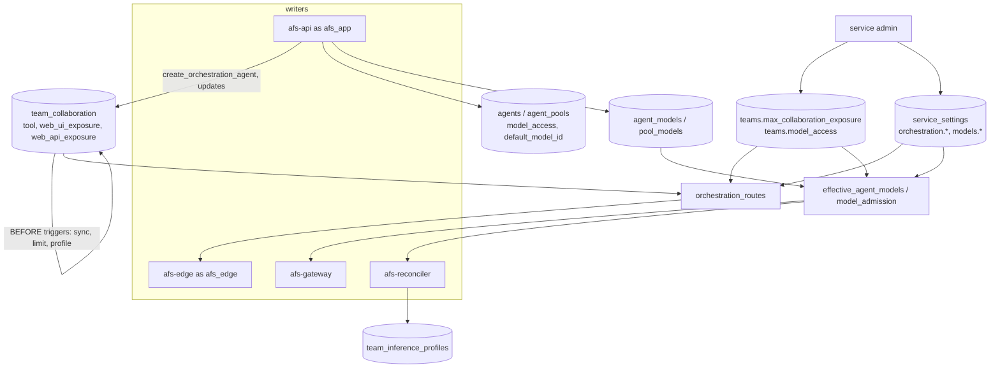

# Architecture

Checks at write time (constraint names in `data-dictionary.md`) are `BEFORE` triggers; checks that need several rows in a transaction (required orchestration agent, non-empty selection, default inside the selection, tool and template agreement) are deferred constraint triggers, checked at commit.

The edge never reads a table: it calls `orchestration_routes()` and `orchestration_settings()`, `SECURITY DEFINER` functions with a pinned `search_path`.
